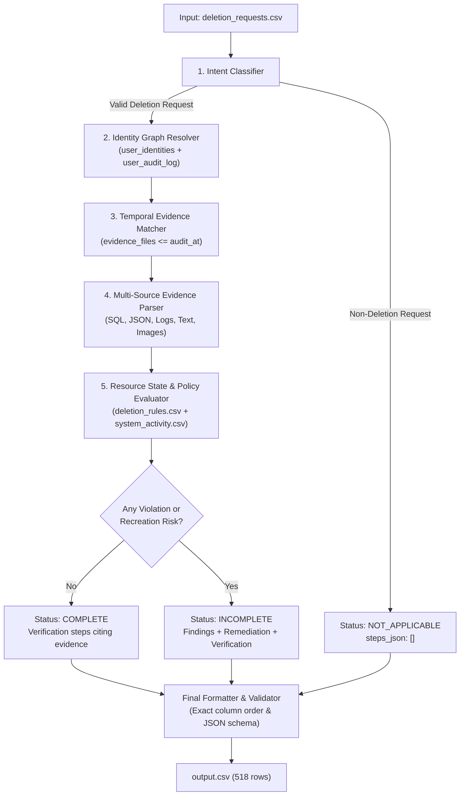

# Project Execution Plan: Ghost Data Still Exists
**HackerRank Orchestrate — October 2026**

---

## 1. Challenge & Scenario Summary

In this challenge, Northstar Shop needs an automated **AI-powered Deletion Audit Agent**.
Even when internal systems claim a deletion request is `COMPLETE`, personal data often lingers in secondary databases, read replicas, failover snapshots, logs, support tickets, search indexes, analytics cohorts, customer exports, or active sync connectors and backup archives.

### Core Objectives:
1. **Determine Request Validity**:
   - Verify whether the user's request actually authorizes deletion (`COMPLETE` / `INCOMPLETE`).
   - If the user asked for something else (access, export, rectification, marketing opt-out, status inquiry), classify as `NOT_APPLICABLE` with `steps_json = []`.
2. **Resolve Identity Graph**:
   - Reconstruct all current and historical identifiers (`user_id`, emails, phone numbers, email hashes) using `user_identities.csv` and `user_audit_log.csv`.
3. **Temporal Evidence Evaluation (`<= audit_at`)**:
   - Audit the exact state of resources at or before `audit_at`.
   - Never use information or evidence captured *after* `audit_at`.
4. **Enforce Deletion Rules (`deletion_rules.csv`)**:
   - Differentiate records that must be deleted (`USER_PROFILE`, `SECONDARY_IDENTIFIER`, `SEARCH_INDEX_ENTRY`, `CACHE_ENTRY`, `USER_EXPORT`, `MARKETING_PROFILE`, `SUPPORT_ATTACHMENT`).
   - Identify records requiring redaction or anonymization (`SUPPORT_MESSAGE`, `EMAIL_DELIVERY_LOG`, `ANALYTICS_PROFILE`, `PRODUCT_TELEMETRY`, `ACCOUNT_TOMBSTONE`).
   - Respect policy-mandated retention (`SECURITY_AUDIT_LOG`, `LEGAL_HOLD_RECORD`, `BACKUP_ARCHIVE`).
5. **Detect Recreation Risks & Active Data Flows**:
   - Detect active sync connectors (`REPORT_ACTIVE_DATA_FLOW`) and unblocked restore capabilities (`REPORT_RESTORE_RISK`).
6. **Synthesize Ordered Steps (`steps_json`)**:
   - For `COMPLETE` cases: verification steps only, citing the participant evidence proving the compliant state.
   - For `INCOMPLETE` cases: findings (citing evidence), remediation actions (disabling data flows, blocking restores, deleting/redacting/anonymizing records), and post-remediation verification checks.
   - Follow strict phase order: `FINDING` -> `REMEDIATION` -> `VERIFICATION`.
   - Within each phase, follow operation priority, then sort by `system_id` and `resource_id` ascending.

---

## 2. Architecture & Pipeline Breakdown



### Module 1: Request Intent Classifier (`intent_classifier.py`)
- Analyzes `request_text` across multiple languages (English, French, Spanish, Portuguese, German, Japanese, Korean, Arabic, etc.).
- Categorizes request into:
  - **DELETION**: Account deletion, erasure, account closure with personal data removal, right to be forgotten.
  - **NON_DELETION (`NOT_APPLICABLE`)**: Data export/portability, login assistance/access, rectification of phone/name/email, marketing newsletter unsubscribe only, invoice copies, data inventory inquiries.

### Module 2: Identity Graph Resolver (`identity_resolver.py`)
- Maps the request's `email` (which may be current or historical) to the canonical `user_id`.
- Reconstructs all identity attributes across time:
  - `user_id`
  - Current and historical email addresses
  - Current and historical phone numbers
  - Current and historical names
  - SHA-256 email hashes (and recalculates hash for all discovered email variations)

### Module 3: Evidence Ingestion & Parsing Engine (`evidence_engine.py`)
- Manifest tracking: Filters 94 evidence files by `captured_at <= audit_at`.
- Specialized parsers:
  - **SQL Snapshots** (`dataset/evidence/databases/*.sql`): Parsed using in-memory SQLite tables. Queries `customer_profiles`, `customer_search_documents`, `customer_analytics_profiles`, `support_records`, `customer_exports`, `connector_subscriptions`, `backup_restore_entries`, `security_audit_records`.
  - **JSON & Text Records** (`dataset/evidence/records/*`): Reads service resource exports, customer handover documents, and snapshot bundles.
  - **Log Streams** (`dataset/evidence/logs/*`): Regex/key-value parser for structured trace events, PII scan warnings, index query results, and service lookups.
  - **Document & Screenshot Extractors** (`dataset/evidence/documents/*` and `dataset/evidence/images/*`): Text extraction from PDFs and OCR metadata maps for UI consoles.

### Module 4: Audit & Policy Engine (`audit_engine.py`)
- Evaluates each relevant user resource against `deletion_rules.csv`:
  - **`account_service` / Profiles**: If profile exists and is active -> `REPORT_REMAINING_RECORD`. If tombstone with direct PII -> `REPORT_EXPOSED_PII`. If tombstone with only `user_id` -> compliant (`VERIFY_RECORD_REDACTED` or `VERIFY_RECORD_ABSENT`).
  - **`search_service` / Search Docs**: Must be absent. If found -> `REPORT_REMAINING_RECORD`.
  - **`analytics_platform`**: If attributes link back to user (email/phone/hash present) -> `REPORT_EXPOSED_PII`. If anonymized (null identifiers) -> compliant (`VERIFY_RECORD_ANONYMIZED`).
  - **`support_platform`**: Shared support message with PII -> `REPORT_EXPOSED_PII`. Dedicated attachment -> `REPORT_REMAINING_RECORD`.
  - **`integration_service` / Connectors**: If connector is enabled (`enabled=1`) -> `REPORT_ACTIVE_DATA_FLOW`.
  - **`backup_service` / Backups**: If restore is permitted (`restore_allowed=1`) -> `REPORT_RESTORE_RISK`.
  - **`security_service` / Audit Logs**: If retention period is active -> must be retained (`VERIFY_RECORD_PRESENT`).

### Module 5: Remediation & Verification Plan Synthesizer (`plan_synthesizer.py`)
- Generates canonical steps with precise schema:
  - Phase 1: `FINDING` (`REPORT_REMAINING_RECORD`, `REPORT_EXPOSED_PII`, `REPORT_ACTIVE_DATA_FLOW`, `REPORT_RESTORE_RISK`), citing participant `evidence_id`.
  - Phase 2: `REMEDIATION` (`DISABLE_DATA_FLOW`, `BLOCK_RESTORE`, `DELETE_RECORD`, `REDACT_RECORD`, `ANONYMIZE_RECORD`), with `evidence_id = ""`.
  - Phase 3: `VERIFICATION` (`VERIFY_RECORD_ABSENT`, `VERIFY_RECORD_PRESENT`, `VERIFY_RECORD_REDACTED`, `VERIFY_RECORD_ANONYMIZED`, `VERIFY_DATA_FLOW_DISABLED`, `VERIFY_RESTORE_BLOCKED`), with empty `evidence_id` for incomplete cases, or cited `evidence_id` for complete cases.
- Strict ordering:
  1. `FINDING` -> `REMEDIATION` -> `VERIFICATION`
  2. Within phase: operation order as specified in `problem_statement.md`
  3. Tie-breaker: `system_id` ascending, then `resource_id` ascending
  4. Consecutive numbering starting at 1.

---

## 3. Step-by-Step Implementation Roadmap

```
┌─────────────────────────────────────────────────────────────┐
│ Phase 1: Ground Truth Calibration & Evidence Analysis       │
│ • Reverse-engineer 32 samples in sample_output.csv          │
│ • Validate 100% agreement on all sample cases               │
└──────────────────────────────┬──────────────────────────────┘
                               │
┌──────────────────────────────▼──────────────────────────────┐
│ Phase 2: Core Engine Development (code/)                    │
│ • code/main.py: Modular end-to-end audit pipeline           │
│ • Implement intent, identity, evidence, policy modules      │
└──────────────────────────────┬──────────────────────────────┘
                               │
┌──────────────────────────────▼──────────────────────────────┐
│ Phase 3: Evaluation Suite & Reporting                       │
│ • code/evaluation/evaluation_report.md                      │
│ • code/evaluation/usage_report.md                           │
│ • Create 3+ novel evaluation test cases                     │
└──────────────────────────────┬──────────────────────────────┘
                               │
┌──────────────────────────────▼──────────────────────────────┐
│ Phase 4: Full Dataset Run & Submission Verification         │
│ • Run pipeline on all 518 evaluation cases                  │
│ • Output validation: root output.csv (518 rows, sorted)     │
│ • Package code.zip and verify logs in log.txt               │
└─────────────────────────────────────────────────────────────┘
```

---

## 4. Key Rules & Constraints Checklist
- [x] Every turn logged to `log.txt` with exact `tool=antigravity-cli` and `model=Gemini 3.8 Flash (Medium)`.
- [x] Use strictly participant-facing data in `dataset/`.
- [x] No evidence created after `audit_at` can influence the decision.
- [x] Output must be 518 rows sorted by `case_id`, written to root `output.csv`.
- [x] `code.zip` packaging: only `README.md` and `code/` (with `code/evaluation/`), no datasets or caches.
